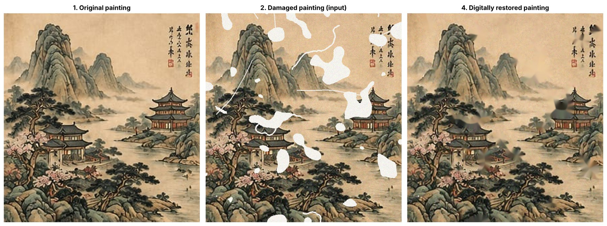
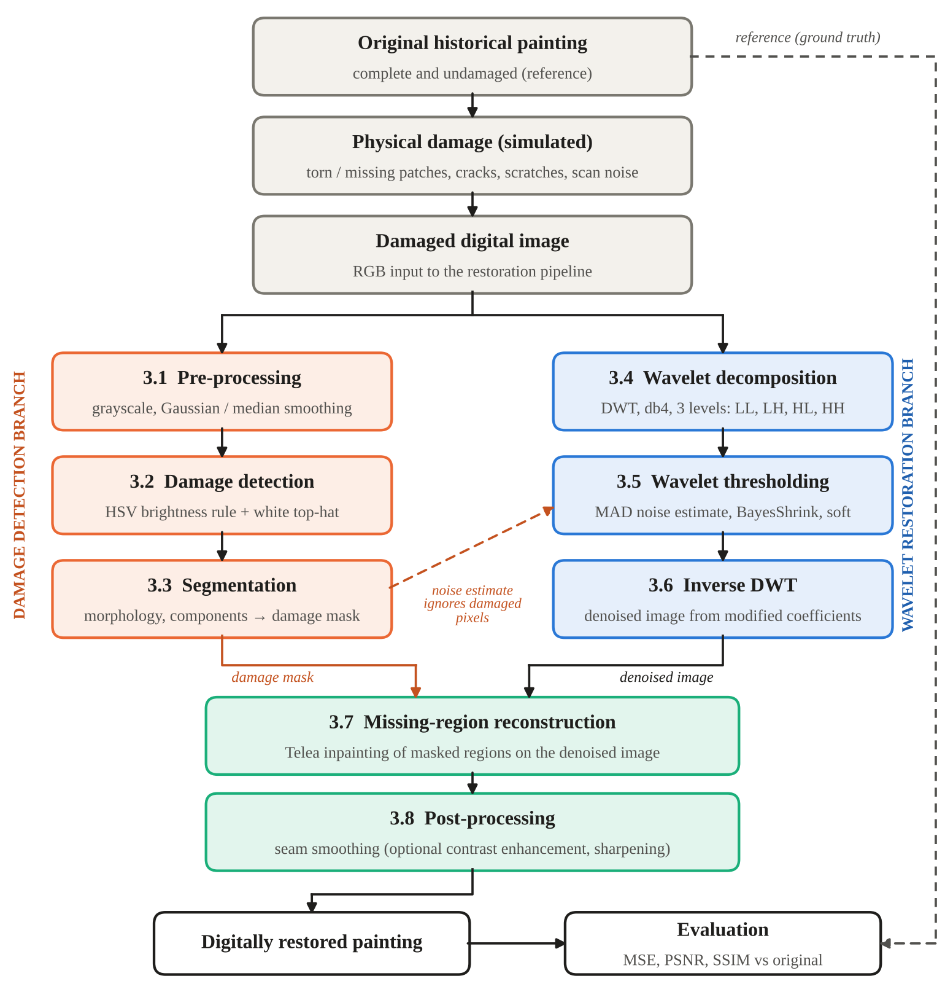

# Wavelet Transform Based Restoration of Damaged Chinese Painting

[](https://colab.research.google.com/github/rugvedibind/wavelet-painting-restoration/blob/main/notebooks/DIP_Wavelet_Restoration_Chinese_Painting.ipynb)
[](https://YOUR-APP-NAME.streamlit.app)

Digital Image Processing case study (RBU, EN, DIP 2026–27). A damaged digital image of a traditional Chinese landscape painting is restored with an eight-stage pipeline: the damage is detected automatically, noise is removed with the discrete wavelet transform (DWT) and BayesShrink thresholding, and missing regions are filled by inpainting. Results are evaluated against the undamaged original with MSE, PSNR and SSIM.



## Results

| Method | MSE ↓ | PSNR (dB) ↑ | SSIM ↑ |
|---|---:|---:|---:|
| Damaged image (input) | 1589.63 | 16.12 | 0.565 |
| Telea inpainting only | 330.27 | 22.94 | 0.612 |
| Navier–Stokes inpainting only | 337.83 | 22.84 | 0.611 |
| Wavelet denoising only | 1436.84 | 16.56 | 0.793 |
| Wavelet-domain iterative inpainting | 284.93 | 23.58 | 0.817 |
| **Wavelet + inpainting (proposed)** | **217.00** | **24.77** | **0.835** |

- Damage detection: recall 1.000, Dice 0.895, 54 damaged regions found
- Noise on intact paint reduced by 53.4% (error std 0.0498 → 0.0232)
- Inside the holes every inpainting method scores about 16.8 dB; the gain comes from denoising intact paint (+4.08 dB vs Telea)
- About 0.3 s per 720 × 768 image on a CPU

## Pipeline



| Stage | What it does |
|---|---|
| 3.1 Pre-processing | Grayscale, Gaussian and median smoothing (for detection only) |
| 3.2 Damage detection | HSV brightness rule for losses + white top-hat for scratches |
| 3.3 Segmentation | Morphology, connected components, 2 px safety margin → damage mask |
| 3.4 DWT | db4 wavelet, 3 levels, per RGB channel (LL, LH, HL, HH) |
| 3.5 Thresholding | MAD noise estimate, BayesShrink, soft thresholding of detail bands |
| 3.6 Inverse DWT | Denoised image from the modified coefficients |
| 3.7 Reconstruction | Telea inpainting of the masked regions |
| 3.8 Post-processing | Seam smoothing (optional CLAHE + sharpening, reported separately) |

## Interactive app (Streamlit)

`app.py` wraps the same pipeline (`restoration.py`) in a web app:

- **Simulate damage** on the reference painting or your own clean image, tune every stage from the sidebar, and see MSE, PSNR, SSIM, detection scores, wavelet sub-bands and a method comparison update live.
- **Restore my damaged image**: upload a real damaged photo, adjust the detection thresholds, and download the restored PNG.

With the default settings it reproduces the results table above.

Run it locally:

```bash
pip install -r requirements.txt
streamlit run app.py
```

## How to run the notebook

1. Click the **Open in Colab** badge above (or upload the notebook from `notebooks/` to [Google Colab](https://colab.research.google.com)).
2. In the **Configuration** cell, set `IMAGE_SOURCE = "upload"` to reproduce the numbers above.
3. **Runtime → Run all**, and upload `data/reference_painting.png` when prompted. A CPU runtime is enough; the full notebook takes about a minute.
4. All figures and tables are saved to `/content/results/` and downloaded as `dip_wavelet_results.zip`.

With `IMAGE_SOURCE = "sample"` the notebook instead downloads a public-domain painting from Wikimedia Commons (Ma Yuan, *Walking on a Mountain Path in Spring*); the numbers will differ from the table above.

To run the notebook locally instead of Colab: `pip install -r requirements.txt jupyter`, open it in Jupyter, and set `IMAGE_SOURCE = "path"` with `IMAGE_PATH = "../data/reference_painting.png"`.

## Repository structure

```
app.py         Streamlit web app
restoration.py Restoration pipeline as reusable functions
notebooks/     Colab notebook with the complete pipeline and experiments
data/          Reference (undamaged) painting used for the reported results
results/       Figures and CSV tables produced by the notebook
docs/          Case-study report (.docx) and presentation (.pptx)
```

## Authors

Rugvedi Bind, Pratiksha Bajanghate, Thaneesha Fender
Guide: Dr. Vicky Butram
Department of Electronics and Computer Science, Ramdeobaba University, Nagpur

## Key references

- S. G. Mallat, "A theory for multiresolution signal decomposition: the wavelet representation," IEEE TPAMI, 1989.
- S. G. Chang, B. Yu and M. Vetterli, "Adaptive wavelet thresholding for image denoising and compression," IEEE TIP, 2000.
- A. Telea, "An image inpainting technique based on the fast marching method," Journal of Graphics Tools, 2004.
- Z. Wang et al., "Image quality assessment: from error visibility to structural similarity," IEEE TIP, 2004.
- G. R. Lee et al., "PyWavelets: A Python package for wavelet analysis," JOSS, 2019.

The full reference list is in the report in `docs/`.
